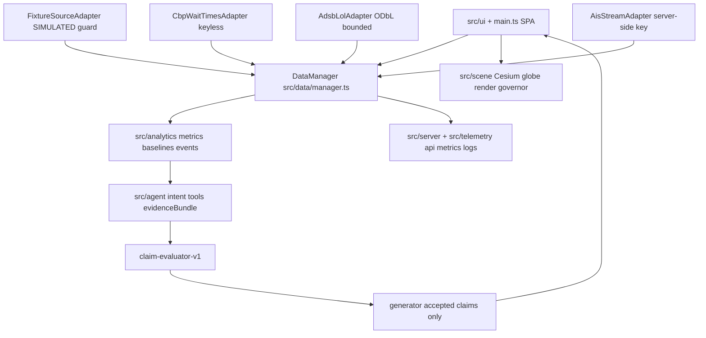
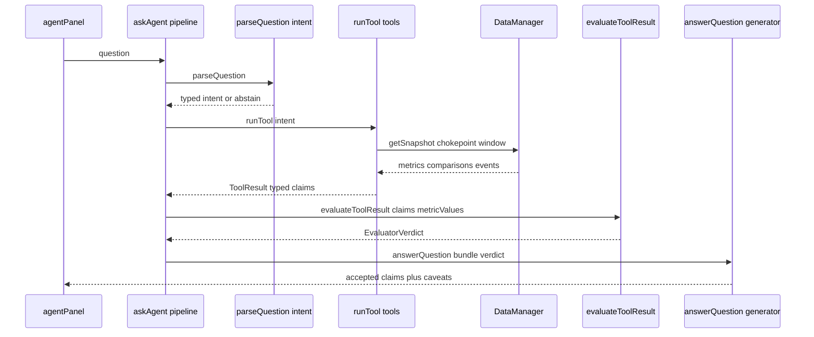

# chokepoint_app — Master Explainer
Repo: <https://github.com/PCSchmidt/chokepoint_app> · Live demo: <https://pcschmidt.github.io/chokepoint_app/> · License: MIT · Last commit: 2026-09-28 (`ff19939`)
Status: portfolio prototype / fixture-mode demo + local observability stack · active bursts 2026-09-09 → 2026-09-28; paused or done [Unknown]
Explainer generated: 2026-10-18 by an AI agent under Chris Schmidt's direction · Questionnaire v1.1 · Depth: LITE (LITE run)

> Tags: **[Verified]** seen in code/commits/CI config · **[Measured]** run in this session — none: this LITE pass executes nothing from the repo, so test/benchmark results are **[Documented]** from committed artifacts or **[Unknown]** · **[Documented]** stated in the repo's docs · **[Author]** confirmed line of `AUTHOR_CONTEXT.md` · **[Inferred]** reasoned (basis stated) · **[Proposed]** not in the repo · **[Unknown]** → §26. "The repo reports…" = the claim is the repo's own. Line refs to commit `ff19939`. One fact, one home; running lists in §20–§27.

## TL;DR

**V.1** Chokepoint answers "how busy is this chokepoint compared to normal, and what evidence supports that?" over public movement signals (ship AIS, aircraft, border wait times), with a provenance label on every number and an answer layer that structurally cannot say more than its evidence. [Verified] `src/analytics/metrics.ts`, `src/agent/pipeline.ts` `askAgent`, `src/agent/evaluator.ts`

**V.2** Built for the author's AI-engineering portfolio; the interesting part is trust discipline, not any model: a source-admission gate (OpenSky *rejected* on its own written terms; AISStream admitted as documented risk acceptance), reject-never-clamp normalization, reviewed geofences behind a named-human gate, truth states where zero observations render "coverage unknown, not zero", and a claim evaluator the generator cannot bypass [Verified] `docs/decisions/ADR-0010..0015`, `src/data/fixtureLoader.ts`, `src/agent/generator.ts`. The repo reports 341 offline tests, detector precision 1.0 / recall 0.75 on a small labeled suite, groundedness 25/25, replay render mean 4.4 ms within budgets [Documented] `evaluation-reports/`, `research/perf/`. Three cautions: (1) the evaluator's numeric gate accepts a number matching *any* metric value, with a percent-fuzzy window and a blanket LIMITATION/QUALITY exemption — weaker than the README's "every number checked" (W-AI-1) [Verified] `evaluator.ts` `numberSupported`; (2) the live-coverage claim (571 records) cites `research/smoke/smoke-run-2026-09-09.log`, gitignored and absent, so it cannot be re-checked (W-EVAL-1) [Verified]; (3) `CONTRACT.md` still says the metrics and live adapters "are not implemented yet" (W-CODE-1) [Verified].

## Repository fact sheet

| Field | Value | Tag |
| --- | --- | --- |
| Name · URL · visibility · license | chokepoint_app ("Chokepoint", ADR-0008) · github.com/PCSchmidt/chokepoint_app · public · MIT (SPDX; `LICENSE`, ADR-0009) | [Verified] |
| One-line description (from code) | fixture-first pipeline: normalize observations → geofence metrics → baselines → threshold events → evaluator-gated answers over a Cesium globe UI | [Verified] `src/` |
| Category / flags | full-stack data+UI app, portfolio demo · `[UI]` `[API]` `[DATA]` `[MATH]` `[DEPLOY]`; no `[AI]` model calls, no `[AGENT]` loop in code | [Inferred] |
| Status | prototype/portfolio demo; plan phases 0–5 complete; Phase 6 = HOLD on fixture static beta | [Documented] `STATUS.md`, beta memo |
| Languages · size | TypeScript 105 files / ~16.5k lines (src 68/13.5k; tests 49/7.4k), CSS 2.6k, 34 docs ~5.6k lines; 201 tracked files | [Verified] `git ls-files` |
| Tests · count | tests/unit (27 files) + tests/evaluation (2); recount 337 `it`/`test` + one 4-case `it.each` = 341 = the claim | [Verified] |
| Test pass status | repo reports 341 passing, offline, deterministic; CI runs the same suite | [Documented]; not re-run here |
| Commits · history | 63 commits, `main` only, 2026-09-09 (36) → 09-10 (24) → 09-15 (2) → 09-28 (1); no tags/PRs; identities "Chokepoint Dev" (36) / "Chris Schmidt" (27); one `Co-Authored-By` trailer (Claude Opus 5.5, `ff19939`) | [Verified] |
| Entry points | SPA `src/main.ts` (967 lines); `npm run dev` (:5174 strictPort), `npm run serve` → `src/server/server.ts` (:8787), `docker compose up`; scripts `eval`, `eval:agent`, `perf:replay`, `qa:browser`, `smoke` | [Verified] `package.json` |
| Clean clone · CI | not executed per run brief; README documents `npm install && npm test` green. `ci.yml`: Node 22, `npm ci` → `tsc --noEmit` → `npm test` → `vite build`; `deploy.yml`: build → Pages. No coverage/style/dependency scan | [Documented] / [Verified] |
| Live demo | https://pcschmidt.github.io/chokepoint_app/ (static fixture SPA); repo reports live verification, screenshots committed | [Verified]/[Documented] |
| External services · paid APIs | none at runtime in fixture mode; live adapters: AISStream (server key), adsb.lol, CBP bwt (keyless); keyless Esri/OSM/NE2 tiles | [Verified] `src/data/` |
| AI coding tools evidenced | one Claude Opus 5.5 trailer; `AGENTS.md` is the *product's* contract, not a coding-agent instruction file; agents wrote most code (author) | [Verified]; [Author] |
| Related repos | `gods-eye-view` fork named as inspiration seed (`DATA_SOURCES.md` §3.1); family links from `AUTHOR_CONTEXT.md` (⚠ = [Inferred]) | [Documented]/[Inferred] |
| Headline claims | 15 audited in §11 (CL-01…CL-15) | [Verified] |
| Scripts that write tracked files (not run) | `eval`/`eval:agent` → `evaluation-reports/`; `perf:replay` → `research/perf/`; `qa:browser` → `research/qa/`; `smoke` → gitignored logs | [Verified] |
| Tests needing external resources | none by design (injected transports; network-free CI); browser suites drive local Vite via Playwright | [Verified] |

## 1. For everyone: what it does and why it matters (A)

- **A.1 ★** One sentence: it answers "how busy is this chokepoint versus normal, and what evidence supports that?" with a provenance label on every number. [Verified] `README.md`, `src/`
- **A.2 ★** Everyday problem: scattered feeds with unknown coverage make "quiet" and "unobserved" look identical and estimates get read as facts; before it, a user tab-hopped AIS maps, CBP pages, spreadsheets. [Inferred] `CHOKEPOINT-PLAN.md` §1.1.
- **A.5 ★** Analogy: a newsroom with a strict editor — reporters (adapters) file copy, the fact desk (metrics) computes checkable numbers, nothing prints unless the editor (claim evaluator) verifies every figure and strips sensational language.
- **A.7** Data: SIMULATED fixtures for everything demo-visible; keyless live adapters (CBP, adsb.lol, AISStream) exercised at manager level in tests; the SPA is fixture-mode by design. [Verified] `src/data/manager.ts`
- **A.10 ★** Can't do: see vessels outside source coverage; separate bulk carriers from cargo by AIS type codes (disclosed); compute a congestion index (deferred); make causal/intent claims ever (`NON_CLAIMS.md`); rail movement (deferred); fences are demo geometry, not official boundaries. [Documented]
- **A.11** Cost to run: $0 credentials (keyless/fixture); a laptop and free Pages hosting. [Verified] `.env.example`, `docker-compose.yml`
- **A.13** Built in ~3 weeks of bursts (2026-09-09 → 09-28) with Chris Schmidt directing AI coding agents: "very little code written by Author", all development by LLMs/agents [Author] 2026-10-18. [Verified] `git log`
- (Other A items where material: users = author + reviewers only; first session = launcher → globe investigation; trust cues = SIM badges, truth states, evidence drawer; privacy = no person tracking, `SECURITY.md` §3.)

Improvement records: W-SCOPE-1 (Low table §20).

## 2. Purpose, problem, users and use cases (B)

- **B.1 ★** Problem: fragmented movement data with unknown coverage makes analysts over-read noisy maps and tools present estimates as facts; who: analysts reasoning about chokepoint congestion from open feeds (here, the author); frequency: every investigation. [Inferred] `CHOKEPOINT-PLAN.md` §1.1–1.2.
- **B.11 ★** Primary user: a freight/maritime analyst persona; secondary: a reviewer/hiring manager auditing claims; edge case (multi-user alerting) unserved by design (Phase 6 HOLD). Needs basic AIS literacy.
- **B.12 ★** Use cases (inventory §3): (1) vessel counts vs a prior window — **working**; (2) detect notable changes (queue buildup, stoppage, flow surge/drop) — **working** on labeled fixtures; (3) plain-language questions with evidence-backed answers — **working**; (4) wait times + aircraft in one product — **partial** (manager-level wiring only); (5) alerts/notifications — **planned/not built**.
- **B.13 ★** Journey: pick a chokepoint → manager snapshot → metrics + comparisons + events on HUD/timeline → evidence drawer (formula, inputs, provenance) → question → intent → tool → bundle → verdict → answer. Supports "is this above normal, and can I trust the number" only.
- **B.18 ★** Out of scope: intent/cause/threat/completeness claims, official statistics, person tracking, accounts/persistence, live browser data, rail, mobile, data purchases (HOLD with reopen triggers). [Documented] `NON_CLAIMS.md`, beta memo
- **B.19 ★** Success measured: 341 tests green; detector P/R 1.0/0.75; groundedness 25/25; replay budgets PASS; pixel QA — all committed artifacts. No user-facing metric is measured; the beta memo calls the two user questions unanswerable without first-use data. [Documented]
- (Material non-★: B.10 unmet = live browser path §10.2, congestion index §7.5, multi-profile agent compare; B.23 regulated use needs the §16.2 review (rate limiting, non-root container, hosted key proxy [Documented]).)

## 3. Capabilities inventory (B.12, J.1)

| Capability | State | Evidence |
| --- | --- | --- |
| Canonical observation model; reject-never-clamp validation, dedupe/order, stable entity identity | working | [Verified] `observation.ts` |
| SIMULATED fixture pipeline with hard provenance guard | working | [Verified] `fixtureLoader.ts` |
| Source health machine (FRESH…NEVER_ANSWERED); six metrics with formula versions + quality blocks | working | [Verified] `sourceHealth.ts`, `analytics/metrics.ts` |
| Baselines + threshold event detector + detector metrics (starter thresholds); reviewed geofence registry (9 fences) + placeholder gate | working | [Verified] `baselines.ts`, `events.ts`, `geofences.ts` |
| Live adapters: AISStream, adsb.lol, CBP | built/tested at manager level; demo unwired | [Verified]; [Documented] |
| Globe UI: network view, HUD, replay, event cards, evidence drawer, share links, watchlist, story | working | [Verified] `main.ts`, `src/ui/` |
| Verified agent (intents → tools → bundles → evaluator → templates) + voice; observability (/api/*, /metrics, logs, Prometheus+Grafana) | working; no LLM; ops local | [Verified] `src/agent/`, `src/server/` |
| Congestion index, live browser data, rail, multi-profile compare, notifications | planned/deferred | [Documented] plan §7.5 |

## 4. Domain perspective (C)

- **C.1 ★** Domain: maritime transportation intelligence plus air/land freight context (chokepoints, anchorage dwell, port entry/exit, border crossings). Concepts match AIS-analytics practice; ITU ship-type codes 70–89 for cargo/tanker and AIS sentinels (SOG 102.3, heading 511) as "not available" per ITU-R M.1371 — correct convention. [Verified] `src/data/ais.ts`
- **C.2** Followed: ITU-R M.1371, ITU ship types, WGS84/EPSG:4326, ISO 8601. Not followed: IMO Ships' Routeing / official SCA zones — strait and Suez fences all-APPROX (disclosed `research/geofence-candidates.md`, KNOWN-2).
- **C.3–C.5** Expert flags: planar ray-casting (deliberate); coarse demo fences; bulk carriers inseparable from cargo (disclosed); aircraft cohorts inferred from callsigns, labeled `inferred`. Not modelled: current/set drift, tides, dark vessels — coverage caveats only.
- **C.6–C.9** Admission outcomes: AISStream (risk-accepted, ADR-0010 — no data-use ToS exists), adsb.lol (ODbL 1.0, ADR-0012), OpenSky (rejected — written agreement required, ADR-0012), CBP bwt (keyless, US-gov, ADR-0013), FRA rail (deferred, ADR-0014). Provenance per observation and per metric (one record per provider); stale/missing → STALE/UNKNOWN; empty population → "coverage unknown, not zero". [Verified] `src/data/provenance.ts`
- **C.10–C.13** Method: documented formulas + threshold rules, then language gating; an expert would accept the definitions but demand calibration — thresholds are the repo's own "starter demo values"; claim `confidence` values (0.95/0.7/0.85/0.6) are hand-set constants (`tools.ts` `snapshotClaims`), unused by the evaluator.
- **C.15 ★** Would a professional trust it for a real decision? Not yet, and the repo says so: it needs live validated data, calibrated thresholds, official geometry, longer coverage windows (Suez's "coverage unknown" rests on one 5-minute smoke). [Documented] README Limitations
- **C.17–C.18** Harm bounded by the language discipline (`NON_CLAIMS.md`; THREAT/INTENT/CAUSE always rejected); a wrong figure could mislead a casual reader — SIM badge + evidence drawer mitigate. ToS via the admission gate; no personal tracking; ODbL honored. [Verified]
- **C.14** Domain-expert review: [Unknown] → §26.

Improvement records: W-DOM-1.

## 5. Codebase guide (D)

- **D.1 ★** Tree: `src/` — core `data/`, `analytics/`, `agent/`; product `ui/`, `overlays/`, `scene/` (Cesium), `app/`, `server/`, `telemetry/`, `config/`, `main.ts` glue. `tests/` — `unit/` 27 files, `evaluation/` suites, `fixtures/` 17 SIMULATED JSON. `scripts/` (eval/QA/serve/smoke). `docs/` (15 ADRs, security review, case study, beta memo). `evaluation-reports/`, `research/` (artifacts, provider research, geofence candidates), `observability/`. Root contracts: `CHOKEPOINT-PLAN.md` (source of truth), `CONTRACT.md`, `AGENTS.md`, `STATUS.md`, `DATA_SOURCES.md`, `NON_CLAIMS.md`, `SECURITY.md`. Deletable: `research/`, `observability/`.
- **D.2 ★** Entry points: `src/main.ts`; `npm run dev` (:5174); `npm run serve` → `src/server/server.ts` (:8787); `docker compose up`; six tsx scripts (fact sheet).
- **D.3 ★** Run: Node 20+ (CI: 22), npm; `npm install && npm test`; `npm run dev`; production `npm run build && npm run serve` or compose. No env vars; `AISSTREAM_API_KEY` optional, server-side. Not executed here [Documented]; repo reports commands verified on the author's machine.
- **D.7 ★** Key files: `observation.ts` (`normalizeObservation`, reject-never-clamp); `manager.ts` (`getSnapshot`, single data path); `analytics/metrics.ts` (metrics + `DerivedMetric`); `geofences.ts` (`geofenceMembership`, ADR-0007 gate); `agent/evaluator.ts` (`evaluateClaim`, trust boundary); `agent/tools.ts` (`runTool`); `agent/pipeline.ts` (`askAgent`); `main.ts`; `server/server.ts`; `config/chokepoints.ts`.
- **D.8 ★** `askAgent` best captures the purpose: typed intent → one allowlisted tool over a manager snapshot → content-addressed bundle → evaluation against the same metric values → accepted claims only; abstentions and UI actions first-class; wall clock never read. [Verified]
- **D.9–D.10** Most non-obvious: the network-view entity-id discipline (prefixed ids, one merged `showObservations` — sequential refresh clobbers via the `"@"`-removal heuristic) and `pulsePixelSize`'s Julian-date fix (nonexistent `julianDateNumber` → NaN pixelSize → Cesium `updateFrustums` crash, `723f8ba`). Most fragile: `main.ts` + render-governor (two harness-caught regressions).
- **D.13** Errors: normalization returns `{ok:false, reason}` (never throws on bad records); preconditions throw; server crashes → stable envelope; agent failures surface as refused/unavailable notes. [Verified]
- **D.17 ★** README accuracy is high; discrepancies in this pass: **7** (§24), most important `CONTRACT.md` §3/§5/§7 "not implemented yet" contradicting shipped code. GitHub description still says "maritime" only.

Improvement records: W-CODE-1, W-CODE-2.

## 6. Tech stack and rationale (E)

| Layer | Technology | Why (tag) | Trade-off accepted |
| --- | --- | --- | --- |
| Language | TypeScript strict (+ `noUncheckedIndexedAccess`, `exactOptionalPropertyTypes`) on Node 20/22 | "boring, well-supported tooling" [Documented] README | TS 7.x is a very new major |
| Frontend | Vanilla DOM + Vite 8, no framework | deliberate (plan §9.1: pure view models) | hand-rolled rendering in `main.ts` |
| Visualization | CesiumJS 1.145 keyless (ADR-0003); Esri satellite default, NE2 offline fallback | no token, reviewable | ~4 MB bundle |
| Server | dependency-free `node:http` | zero-dependency ops surface | hand-written routing/MIME |
| Storage | none durable; bounded buffers (AIS ≤5000 / 72h TTL); localStorage watchlist | ADR-0010 retention posture | restart loses live buffers |
| Validation | hand-written discriminators | reject-never-clamp contract | no Zod/JSON Schema |
| Test/eval | Vitest 5 (+happy-dom), Playwright 1.63 harnesses, labeled suites + reports | reproducible offline | no coverage/mutation tooling |
| Lint | `tsc --noEmit` only | simplicity | no style linter |
| Ops | multi-stage Dockerfile, compose (app+Prometheus+Grafana), Actions CI + Pages | reproducible local stack | root container (accepted residual) |
| AI coding tools | Claude Opus 5.5 (1 trailer) | [Verified] `ff19939` | attribution thin (W-PROC-1) |

- **E.1 ★** TypeScript because the product is a browser app plus thin server and the plan wanted strict typing as contract enforcement; Python would serve the analytics but not the Cesium product; Go/Rust add nothing at this scale.
- **E.3 ★** Load-bearing deps: **cesium** (the entire scene layer), **vite/vitest/tsx** (one toolchain), **playwright** (QA/perf only), **happy-dom** (UI tests). Everything else is stdlib by design ("dependency-free node:http server and Prometheus registry", README).
- **E.5b ★** Environment drift: artifacts record no package versions; `package-lock.json` + `npm ci` pin the tree; whether today's resolve equals September's is [Unknown] (no re-resolve, per instruction).

Improvement records: W-STACK-1.

## 7. Architecture (F)

- **F.1 ★** Style: client–server sharing one deterministic domain core — a fixture-first pipeline feeding a static SPA and a small local API server; the agent layer is a pipeline, not an agentic loop. Fits the goal (trustworthy demo, not scale).
- **F.2 ★** Components: data layer (`src/data` — the only data path), analytics (`src/analytics`), agent (`src/agent`), UI (`src/ui`, `src/overlays`, `src/scene`, `src/app`, `main.ts`), telemetry + server (`src/telemetry`, `src/server`). [Verified]
- **F.3 ★** Trace a question: `agentPanel.ts` → `askAgent` (`pipeline.ts`) → `buildEvidenceBundle` → `parseQuestion` (`intent.ts`; unmatched → abstain) → `runTool` (`tools.ts`, allowlisted; `getSnapshot` only) → metrics over `normalizeObservation` output → `evaluateToolResult` (`evaluator.ts`) vs the same snapshot's `metricValueMap` → `answerQuestion` (`generator.ts`) renders accepted claims + caveats (panel: EVALUATED/NOT ANSWERED + rejected-claim detail). UI-action intents return a validated `UiAction` applied via app state before any "Applied" wording.

- **F.8 ★** Contracts: `TransportObservation`/`FacilityMetric` schemas (hand-validated), `DerivedMetric` (formula version + inputs + quality), the adapter lifecycle (`enable/refresh/getStatus/getRecords/getAttribution/destroy`), the §5.6 evidence bundle, `EvaluatorVerdict`.
- **F.11 ★** Invariants (probes not executed — the run brief forbids running anything; cases examined by code reading):

| Invariant | Enforcement | Adversarial case | Result |
| --- | --- | --- | --- |
| Invalid coordinates rejected, never clamped | `normalizeObservation` | lat 91, NaN lon | `{ok:false, reason}` [Verified] |
| Simulated never OBSERVED | `assertSimulatedProvenance` | manifest labeled OBSERVED | throws [Verified] |
| Placeholder geometry never computes metrics | `geofenceMembership` | placeholder into `vesselCount` | throws [Verified] |
| Evaluator cannot be bypassed | `answerQuestion(bundle, verdict)` | generator with raw claims | type error [Verified] |
| Every number matches a metric | `numberSupported` | claim citing a wrong metric's equal number | **passes** — matches ANY metric + % fuzzy + category exemption [Verified] → W-AI-1 |
| Empty population UNKNOWN, never zero | `snapshotClaims` noData branch | zero observations | "coverage unknown, not zero" [Verified] |

- **F.19 ★** At 10×/100×/1000×: snapshot assembly and per-refresh sorts are O(n log n), fine at fixture scale; the Cesium scene (governor: 800 points/40 labels/6 cards) and the AIS 5000-record buffer break first, then a hosted variant's missing rate limiting. Beyond 10× [Inferred], unmeasured.
- **F.22 ★** Single point of failure: `DataManager` (UI, agent, watchlist, readiness read it); infra side: the single Node process and GitHub Pages. Mitigation is honest degradation (UNAVAILABLE + fixture fallback), not redundancy.
- **F.24 ★** Five most consequential of 15 ADRs (gained / sacrificed / still right?): ADR-0003 keyless Cesium ($0 reviewability / imagery options / yes); ADR-0007 placeholder throws until a named human reviews (no silent bad geometry / slower adds / yes — it *is* the portfolio signal); ADR-0010 AISStream risk acceptance (first live source / terms ambiguity / demo only); ADR-0012 adsb.lol in, OpenSky out (honest air layer / share-alike / yes); ADR-0015 FacilityMetric separate model (no fake "vessels" / second schema / yes). Most leverage: ADR-0007 + evaluator contract; most burden: `main.ts`. I would tighten the numeric check (W-AI-1).

Improvement records: W-ARCH-1, W-AI-1.

## 8. Data architecture (G)

- **G.1 ★** Enters: provider payloads (AISStream frames, adsb.lol points, CBP wait JSON) or fixture JSON — e.g. a record with `observationId`, `entityId`, `position`, `kinematics`, `observedAt/receivedAt`, `source{providerId,endpointId,licenseId}`, `quality{sourceState,classification}`. Stored: nothing durable (bounded buffers; localStorage watchlist/share state). Leaves: HUD cards, events, evidence drawer, agent answers, `/api/*`, `/metrics`. `FacilityMetric` readings are a separate type keyed by `facilityId`, never merged into entity totals. [Verified] `CONTRACT.md` §2/§2a
- **G.3 ★** Model: `TransportObservation` → `TrackSegment` (gap-based, zero interpolation) → `DerivedMetric` (metricType, scope, value|null, unit, formulaVersion, inputs[], quality) → `BaselineComparison` (itself a DerivedMetric) → `DetectedEvent` → `EvidenceBundle` (bundleId = FNV-1a of question+scope) → `EvaluatorVerdict`. [Verified] `observation.ts`, `metrics.ts`, `evidenceBundle.ts`
- **G.5–G.9** Validation is total (reject-never-clamp, closed vocabularies, negative waits rejected); missing readings omitted ("absent ≠ zero"); duplicates dedupe deterministically; out-of-order fine (total ordering); localStorage corruption tolerated. Unchecked: provider timestamps trusted as given; callsign inference trusts provider metadata. SQL/DuckDB would pay off only with historical replay or multi-user queries [Inferred].

## 9. Algorithms and mathematics (H)

The mathematical machinery in Chokepoint is a set of counting and comparing rules, not a model that guesses. Its job is to turn a stream of scattered movement reports into a handful of numbers a person can argue with: how many freight vessels sit inside a drawn boundary, how many of them are moving, how long they linger, how many crossed in or out — and whether any of that is unusual compared with an earlier window of the same length. It exists because the product's promise is that every displayed number can be recomputed from its inputs by anyone with the formula; an unverifiable score would break the whole trust story. Picture a shift supervisor with a clipboard at a port gate: tally who is inside the painted line, note who is creeping and who is moving, compare today's tally with a typical day, and only call out a change when it is big enough to matter and enough ships were actually seen. The code follows that same order — raw reports are validated and bad ones rejected with a reason, tied to stable vessel identities, tested against the reviewed fence, counted into per-window metrics, compared with a named earlier window, and only then passed to written threshold rules that may raise an event. The event itself carries numbers and windows as provenance and never an explanation; explaining belongs to the evaluator layer (§10).

### The three central methods

**Method 1 — moving fraction: "are things moving, or stuck?"** In plain terms, the app asks each vessel one question — how fast were you going most recently in this window? If the answer is above a chosen cut-off the vessel counts as moving; below it, not moving; and if no speed was ever reported the vessel is left out of the calculation entirely and named in the coverage note, because being invisible to the feed is not the same as sitting still. The result is simply the share of the vessels we can judge that are moving. Formally, \(MF = |\{e : v_e > \tau\}| / |\{e : v_e \text{ observed}\}|\), where \(e\) ranges over the entities seen in the window, \(v_e\) is the latest in-window speed of entity \(e\) in knots, and \(\tau\) is the versioned speed threshold (it must be ≥ 0 — `movingFraction` throws otherwise); entities with no speed observation appear in neither set. If no entity has a speed at all, the value is `null` with quality `unknown`, never zero. Worked example: five vessels report speeds 12, 8, 3 and 0.5 knots and one reports nothing; with \(\tau = 5\) knots, the movers are {12, 8}, so \(MF = 2/4 = 0.5\), and the note names the excluded vessel. One latest reading decides "moving" (no smoothing), the missing-speed exclusion silently shrinks the sample unless the note is read, and the threshold is versioned but not calibrated. [Verified] `src/analytics/metrics.ts` `movingFraction`, `MOVING_FRACTION_FORMULA_VERSION = "moving-fraction-v1"`.

**Method 2 — baseline comparison: "is this unusual for here?"** A bare number means little — 30 waiting vessels is chaos at a small crossing and a quiet afternoon at a mega-port — so the app takes the same metric from a named earlier window and reports two differences: the change in the metric's own units, and the change as a fraction of the earlier value. Tiny wobbles are labelled "stable"; missing values or thin samples make the comparison UNKNOWN rather than a confident estimate; and when the earlier value is zero, the percentage is simply not defined and only the plain difference is kept. Formally, \(\Delta_{abs} = x_{now} - x_{base}\) and \(\Delta_{rel} = \Delta_{abs} / x_{base}\) — the code divides by the absolute value of the baseline, identical to this form for the project's non-negative metrics — with \(\Delta_{rel}\) undefined when \(x_{base} = 0\); here \(x_{now}\) is the metric over the current window and \(x_{base}\) the same metric over the named baseline window. Direction is `increase`/`decrease`/`stable`, where "stable" means \(|\Delta_{rel}| < 0.05\), and `unknown` whenever either side is null or either sample count is below the minimum (3 for detector comparisons; LOW_SAMPLE). Only like metrics compare — same `metricType` and unit, or `compareWithBaseline` throws — and the comparison is itself a `DerivedMetric` carrying the two parent metric ids and `baseline-comparison-v1`. Worked example: the waiting cohort grows from 10 vessels to 30 between equal windows, so \(\Delta_{abs} = 20\) vessels and \(\Delta_{rel} = 20/10 = 2.0\), i.e. +200%, direction "increase"; had the baseline shown 0 instead of 10, the percentage would stay undefined and only the plain difference of +30 vessels recorded. The method assumes the earlier window represents "normal" — a stationarity assumption no one has tested here — and its 5% stable band and sample floors are starter values, not fitted constants. [Verified] `src/analytics/baselines.ts` `compareWithBaseline`, `BASELINE_COMPARISON_VERSION = "baseline-comparison-v1"`.

**Method 3 — threshold event rules: "when to say something changed."** The detector is a short, versioned list of written rules — one per kind of event — and each rule names the metric it watches, which direction of change counts as unusual, and two bars that must be cleared *together*: a percentage bar and a plain-number bar. Requiring both stops a tiny baseline from producing noise, and if the comparison came back UNKNOWN, nothing fires at all. The output is a record of numbers and windows, deliberately without cause or narrative. Formally, an event fires iff the change direction matches the rule's direction, \(|\Delta_{rel}| \ge r\), \(|\Delta_{abs}| \ge a\), and both sample counts are at least 3 — where \(r\) is the rule's minimum relative change and \(a\) its minimum change in the metric's own unit. The default table: `queue_buildup` watches increases in `dwell_cohort_size` with \(r = 0.25\), \(a = 3\); `stoppage` watches decreases in `moving_fraction` with \(r = 0.2\), \(a = 0.05\); `flow_surge` and `flow_drop` watch `entry_count` with \(r = 0.3\), \(a = 2\). Worked example: the 10 → 30 cohort case clears both `queue_buildup` bars (2.0 ≥ 0.25 and 20 ≥ 3) and raises a `queue_buildup` event, while a nudge from 10 to 12 (+20%, +2 vessels) clears neither bar and raises nothing; the committed evaluation's `stoppage` case — moving fraction 0.9 → 0.5 (−44%, −0.4) — cleared the `stoppage` bars and fired [Documented] `evaluation-reports/evaluation-report-2026-09-09.md`. These rule values are the repo's own "starter values for the demo" awaiting calibration, and the never-fire-on-UNKNOWN rule deliberately loses real events on thin baselines — the repo's own known failure KNOWN-1. [Verified] `src/analytics/events.ts` `evaluateEventRule`, `DEFAULT_EVENT_RULES`, `EVENT_DETECTOR_VERSION = "event-detector-v1"`.

**H.17 ★ Assumptions, edges and limits.** The load-bearing assumptions are that planar latitude/longitude geometry is good enough at chokepoint scales (the `geofences.ts` header claims relevance "well under a meter" — [Inferred], unverified), that a prior window stands in for "normal", and that starter thresholds are honest placeholders. Edge inputs are handled consistently: NaN and out-of-range coordinates are rejected before any of this runs (§7 F.11), zero-baseline relative change is undefined by construction, and an empty population yields UNKNOWN, never zero. Complexity is modest — the hot path is the per-refresh sorting of observations, O(n log n), with everything else a linear scan — so a better algorithm would not matter until far larger feeds; numerical error is not a real risk at these magnitudes (counts and fractions in double precision) [Inferred]. Correctness rests on unit tests and the two self-authored labeled suites (§11), not on an external reference implementation.

**H.1 ★ Breadth inventory** (everything else the code computes, one clause each):

| Method | Where | Kind | What it does in plain words |
| --- | --- | --- | --- |
| Coordinate/record validation | `observation.ts` `normalizeObservation` | standard | rejects bad records with a reason instead of silently fixing them |
| Deterministic dedupe + total ordering | `observation.ts`, `metrics.ts` `sortedCopy` | standard | duplicate reports collapse to one; every listing comes out in the same order |
| Entity identity `providerId:entityRef` | `observation.ts` `entityKey` | adapted | the same vessel seen twice gets the same name, scoped to its provider |
| ITU classification + sentinel omission | `ais.ts` | standard rules | ship-type codes separate freight from context; "not available" speed/heading values are dropped, never read as zero |
| Even-odd ray-cast point-in-polygon | `geofences.ts` `pointInPolygon` | standard | inside/outside a drawn fence by counting edge crossings (a point exactly on an edge counts as outside) |
| Moving fraction | `metrics.ts` `movingFraction` | original | central method 1 above |
| Dwell estimate (longest in-scope run, gap-bounded) | `metrics.ts` `dwellEstimates` | original | how long a vessel lingers, from its longest stretch of reports without a long gap |
| Entry/exit counts (gap-excluded, uncertain reported) | `metrics.ts` `entryExitCounts` | original | boundary crossings, with doubtful crossings excluded from the count and reported as uncertain |
| Like-metric baseline comparison | `baselines.ts` `compareWithBaseline` | original | central method 2 above |
| Dual-threshold event rules + sample floor | `events.ts` `evaluateEventRule`, `DEFAULT_EVENT_RULES` | original | central method 3 above |
| Detector P/R/F1, FP per entity-hour, mean latency | `detectorMetrics.ts` `detector-metrics-v1` | standard | scores the detector against labeled scenarios |
| FNV-1a content-addressed bundle ids | `evidenceBundle.ts` | adapted | gives each question's evidence bundle a stable fingerprint with no clock |
| Render-governor cohort budgeting | `scene/renderGovernor.ts` | heuristic | keeps the globe inside fixed drawing budgets (800 points / 40 labels / 6 event cards) |

Improvement records: W-MATH-1.

## 10. AI/ML and agent architecture (I)

- **I.1 ★** Hybrid with **zero model calls today**: deterministic analytics + deterministic text; the generative layer is designed-for but absent ("no LLM anywhere in the loop", `pipeline.ts` header). The boundary is pre-drawn: only wording may go generative, behind `claim-evaluator-v1`.
- **I.2 ★** Model call inventory: **none** (code search for openai/anthropic/gpt/ollama finds comments only). Only AI-adjacent runtime: browser Web Speech in `voiceSession.ts` — browser-local, no key, transcripts in memory one turn. [Verified]
- **I.9 ★** Gates: typed-intent parsing with abstention; allowlisted snapshot-only tools; content-addressed bundles; evaluator checks — banned-language regexes (THREAT/CAUSE/PREDICTION/IDENTITY/INTENT), scope-overreach regex, provenance-required, numeric matching against the metric map, freshness/coverage caveats; structural accepted-claims-only rendering. Rule tables live here, not Part H. Tolerance reuse: direct values (1e-9) and ×100 renderings (±0.15) share one matcher regardless of score kind. [Verified] `evaluator.ts`
- **I.18 ★** Essential AI features: none for today's product — deterministic code delivers 100% of current functionality; that is the honest finding. AI value is prospective (`AGENTS.md` lets an LLM replace wording without touching the trust boundary); leverage today: paraphrase robustness of `parseQuestion` (the brittleness hotspot — "how long"→"Long Beach" collision, `63e67a3`). [Verified]/[Inferred]

Improvement records: W-AI-1.

## 11. Evaluation, results and claims audit (J)

**J.1 ★** Levels: nothing here rises above artifact comparison (L1) or arithmetic recomputation from stored counts (L3 for derived numbers); "not re-runnable" flagged.

| ID | Claim (where) | Evidence | Checked | Verdict |
| --- | --- | --- | --- | --- |
| CL-01 | 341 offline tests | recount 337 plain + 4 `it.each` = 341 | L1 | Supported (count); pass = [Documented] |
| CL-02 | Detector P 1.0 / R 0.75 / F1 0.857 | JSON TP 3 FP 0 FN 1; arithmetic recomputed | L3 | Supported — n=4 events, self-authored |
| CL-03 | Groundedness 25/25 | `agent-2026-09-10.json` 25/25 | L1 | Supported (suite co-authored with evaluator) |
| CL-04 | Render 3.0/4.7/5.5 ms (README) | contradicted by `replay-perf-2026-09-16.json` (4.4/6.8/59.2) | L1 | **Contradicted as written** (stale; in budget) |
| CL-05 | QA 29/29 pixels + perf budgets PASS, heap 0% (README) | later QA 69/71; `research/perf/*.json` pass:true | L1 | Supported for their runs; README stale |
| CL-06 | Live smoke 571 records / 123 entities | cited `research/smoke/smoke-run-2026-09-09.log` **absent** (gitignored) | artifact missing | **Unsupported from repo** |
| CL-07 | CBP keyless, 85 US crossings | committed sample = 85 entries (recounted) | L3 count | Supported (count); liveness not re-runnable |
| CL-08 | 9 reviewed geofences, named owner | `config/chokepoints.ts` | direct | Supported |
| CL-09 | Evaluator cannot be bypassed | `answerQuestion` takes a verdict | direct | Supported (structural) |
| CL-10 | "every number checked against metrics" | `numberSupported` matches ANY metric; % fuzzy; exemptions | direct | **Partially supported** |
| CL-11 | Tests need no network/keys; no credentials in repo | injected transports; history scan: only empty `.env.example` | L1/direct | Supported |
| CL-12 | OpenSky rejected on its own terms | ADR-0012 cites terms; raw pages gitignored | not re-checkable | [Documented] |
| CL-13 | Ops verified: compose up (Prometheus up=1), Pages live 40/40 pixels | `STATUS.md`; `pages-live-*.png` | L1 | [Documented] / Supported |
| CL-14 | "AISStream bbox [lat,lon] probe-verified" | `STATUS.md` elsewhere says [lon,lat]; code emits [lat,lon] | direct | **Docs self-contradictory**; probe log missing → [Unknown] |
| CL-15 | Zero observations = "unknown, not zero" | `snapshotClaims` | direct | Supported |

**J.2 ★** Harness: `run-evaluation.ts`/`run-agent-evaluation.ts` regenerate committed reports from shared labeled scenarios; metrics = detector P/R/F1/FP/entity-hour/latency (5 scenarios, 4 labeled events) and groundedness (25). **J.3 ★** Numbers above; reproduce with `npm run eval` / `eval:agent`. **J.4 ★** Baseline: ground-truth labels on the same scenarios used to build the detector; the report discloses recall is capped by the LOW_SAMPLE refusal, thresholds uncalibrated; no tuned baseline. **J.12 ★** No protocol-before-results claim; suites landed with the code (`cd80370`, `4ea3252`). **J.13** Leakage: hand-authored synthetic fixtures; evaluator and test data share authorship — eval numbers are self-assessment.

Improvement records: W-EVAL-1, W-EVAL-2.

## 12. Testing and code quality (K)

- **K.1 ★** 28 test files: per-module units, UI render (happy-dom), server integration, PWA, two labeled suites that also assert rules in CI. Coverage unknown (no tooling).
- **K.2 ★** Not run per instruction; repo reports 341 passing, CI-green [Documented].
- **K.4 ★** CI really checks `tsc --noEmit` → `vitest run` → `vite build`; "lint" = type-check only; CI never regenerates/diffs eval reports (would have caught CL-04).
- **K.6 ★** Spot-checks (real assertions, not implementation mirrors): `geofences.test.ts` (placeholder-throw failure mode), `agent.evaluation.test.ts` (rejection categories on fabricated claims), `cbpWaitTimesAdapter.test.ts` (transform on the archived real sample). [Verified]
- **K.10 ★** Missing: a coincidental-number test ("7 vessels" when `entry_count`=7, `vessel_count`=11 — expected rejection, currently passes [Inferred]); no property-based tests; no README-vs-artifact consistency test.
- **K.11** Greatest validation risk: the trust boundary is validated only by a suite co-written with it.

Improvement records: W-TEST-1, W-AI-1.

## 13. Security, privacy and compliance (L)

- **L.1 ★** Assets: the AISStream API key (the only secret), integrity of displayed numbers, provider-ToS compliance. Threat model implied by `SECURITY.md` + `docs/security-review-2026-09-10.md` (10 PASS, 2 accepted residuals).
- **L.2 ★** Attack surfaces: fixture/provider payloads (schema-validated, reject-never-clamp), share-URL hashes (narrow parsing; corrupt → launcher), question text (simple regexes; ReDoS low), `/api/*` + static server (GET/HEAD, traversal guard), localStorage, service worker (same-origin GET cache; cross-origin never cached).
- **L.5 ★** Secrets: key server-side only with structural log redaction (`telemetry/logger.ts`); `.env` gitignored, `.env.example` empty; history scan (filenames only, no values printed) found no committed secret. [Verified]
- **L.13 ★** An independent review should look first at: `serveStatic`'s `filePath.startsWith(root)` without trailing-separator guard (classic boundary weakness; mitigated by URL dot-segment normalization); the root container; the evaluator's regex lists for bypass/backtracking; rate limiting if ever hosted. Nothing needs immediate fix locally; the repo lists rate limiting, non-root container and a hosted key proxy as deployment prerequisites [Documented].
- (Material non-★: no auth by design; no Dependabot/audit [Verified]; air-gap ready except map tiles — offline NE2 fallback.)

Improvement records: W-SEC-1.

## 14. Performance, reliability, deployment, operations, cost (M)

- **M.1 ★** Cesium rendering/scene refresh dominate; committed: render mean 4.4 / p95 6.8 / max 59.2 ms (budgets 33/250), scrub mean 118 ms (budget 250), idle renders 0, heap 0.0% over 5 mount/unmount cycles [Documented] `research/perf/`.
- **M.6–M.8** Reliability: external calls degrade to UNAVAILABLE + fixture fallback; health/readiness honest (missing key = reported, never a readiness failure); JSON logs with correlation ids. "Demo-grade with honest degradation" met.
- **M.9 ★** Runs on GitHub Pages (live static fixture SPA; repo reports live verification with screenshots [Documented]) and locally via Docker Compose (app + Prometheus + Grafana) or `npm run serve`.
- **M.16 ★** Monthly cost now: $0 (free Pages, local laptop, no paid APIs) [Verified]; at 10×/100× still ~$0 for the static demo; a hosted variant would be dominated by server hosting plus possibly paid AIS history (NOAA/DMA free bulk exist) [Inferred]. Dominant cost today: the author's machine and time.

Improvement records: W-OPS-1.

## 15. Alternatives and trade-offs (N)

- **N.1 ★** Alternatives: (a) pure-LLM analyst over raw feeds — fast demo, hallucinated numbers, exactly what the thesis rejects; (b) BI dashboard over a warehouse — trustworthy tables, but no provenance semantics, honest UNKNOWN, or language discipline. The current design wins for the real goal: demonstrating trust engineering.
- **N.2 ★** Simplest 80% version: fixture JSON + four metrics + evidence drawer; the build is well past that — `main.ts` and the presence layer are what a lean version drops.
- **N.12 ★** Biggest design weakness, plainly: the claim evaluator is a regex/fuzzy checker whose numeric gate can pass by coincidence (W-AI-1) — for a project whose point is checked outputs, the checker is the weakest, least-tested component.
- (Material non-★: abandoned alternatives well recorded — OpenSky rejected, AISHub infeasible, ais.fm defunct, rail deferred, synthetic facility entities rejected; strongest competitor: a Streamlit/Folium dashboard — faster, proves less.)

## 16. Development history and timeline (O)

- **O.1 ★** 63 commits, `main`: **2026-09-09** plan → scaffold → contracts/ADRs → fixtures → metrics → provider research → AISStream adapter + smoke → Cesium UI (36 commits); **09-10** Phase 2 close, verified agent, voice, ops stack, multimodal, Pages deploy, Phase 6 HOLD memo (24); **09-15** network view + presence layer, Cesium NaN crash root-caused (`45b02d1`, `723f8ba`); **09-28** port pin + doc sync (`ff19939`).
- **O.3 ★** Bulk commits are the norm (Phase 3 UI +3,022/−96 in `2c7df10`; network view +2,101; agent +1,880) with detailed messages; intra-phase history irrecoverable. Authorship alternates "Chokepoint Dev" (36) / "Chris Schmidt" (27); one trailer only.
- **O.6** History appears honest and unrewritten (fix commits reference prior bugs; "Fix CI" kept) [Verified]; tool attribution sparse (W-PROC-1).

## 17. How it was built: human + AI collaboration (P)

- **P.1 ★** Evidenced tooling: Claude Opus 5.5 (one trailer, `ff19939`); author states all development work was done by LLMs/agents — mostly Claude Code plus GitHub Copilot, Codex, and Prime-Agent [Author] 2026-10-18; one main tool per project with limited exceptions [Author] (tool-per-phase was [Unknown], now closed). `AGENTS.md` is the product's contract, not a coding-agent instruction file.
- **P.2 ★** AI vs hand share: [Author] 2026-10-18 — "Very little code written by Author"; he framed questions, scope, plan, approach, goals, purpose and architectural preferences; all development done by LLMs/agents. Repo evidence stays consistent: identity split (Chokepoint Dev 36 commits / +18.8k lines vs Chris Schmidt 27 / +14.0k) + one trailer; the "Chokepoint Dev"-as-agent-identity [Inferred] is confirmed, not replaced (§26).
- **P.3 ★** Author-decided (evidenced): thesis/non-promises (plan §1.1–1.2), the admission gate and outcomes including *rejecting* OpenSky, MIT vs per-source licenses (ADR-0009), the named-human geometry gate (ADR-0007), the Phase 6 HOLD, ADR-0015 option b.
- **P.7 ★** Process artifacts: plan (spec), `CONTRACT.md`, `AGENTS.md`, `STATUS.md` (current progress log), `DATA_SOURCES.md` admission records, 15 ADRs, security review — the portfolio's process pattern [Inferred] `AUTHOR_CONTEXT.md`.
- **P.12 ★** Verification discipline: empirical probes settled API ambiguities (`2540e75`); a smoke run found integration bugs; the perf harness caught a replay-cursor bug tests missed; pixel QA exists because `drillPick` lied (STATUS); "Fix CI" commits kept.
- **P.13 ★** Agent-era defects with fixes: the Cesium NaN crash chain and a stale perf harness (`723f8ba`) — introducer [Unknown] per the attribution rule; the "how long"→"Long Beach" regression (`63e67a3`) fixed later.
- **P.19 ★** What the author can explain unaided is [Unknown]; deepest-written areas by evidence are trust semantics (truth states, gate, evaluator); the Cesium scene layer most needs re-study [Inferred].
- **P.26 ★** Approver identity: the gate names `DESIGNATED_GEOMETRY_REVIEW_OWNER` (ChrisSchmidt/PCSchmidt) and records approval in `research/geofence-candidates.md` ("Frames look okay to me"). Maritime v1 landed in a "Chokepoint Dev"-authored commit (`959f01c`), multimodal v1 in a "Chris Schmidt"-authored one (`23e18a2`). No signature or separate approver account; whether the human reviewed each is [Unknown] (§26).
- **P.27 ★** No gate recorded as passed without its criterion — the multimodal phase stopped at the checkpoint ("gate not self-approved", `1140f67`) until the approval record appeared. Disclosure practice is strong (KNOWN failures, accepted residuals, deferred lists).

## 18. Product and research potential (Q)

Value: demonstrating trust engineering for intelligence-style apps — replicable as code in a weekend, evidenced here as process. Research-wise (Q.6–Q.7) mostly engineering; the possibly original part is the evaluator gate + honest-coverage semantics + terms admission; publishability needs held-out evaluation, calibration, expert review. A talk/case study is realistic now; commercial use is blocked on provider terms. [Documented]/[Inferred]

## 19. Limitations, technical debt and roadmap (R)

- **R.1 ★** Known limits (repo explicit): all on-screen data SIMULATED; one 5-minute live window behind coverage claims; inferred aircraft cohorts; coarse geofences; no auth/TLS/multi-user; rail deferred; US-only CBP; uncalibrated thresholds; browser-live path unbuilt. [Documented]
- **R.2 ★** Incomplete/persistent: CL-04 stale README perf; `CONTRACT.md` status sections stale; congestion index and multi-profile agent compare deferred; evaluator numeric gap (W-AI-1) unacknowledged in-repo.
- **R.3 ★** Debt by risk: (1) evaluator numeric gate (trust), (2) `main.ts` monolith, (3) doc/code drift (credibility), (4) uncalibrated thresholds, (5) no coverage/dependency scanning. Effort: (3)(5) small; (1) small-medium; (2)(4) medium.
- **R.9 ★** Next three phases: **(1) Evidence hardening** — commit/replace the smoke evidence, bind `numberSupported` to cited metric ids, README-vs-artifact consistency test; exit: every README number diffs clean. **(2) Analytic validation** — calibrate thresholds on historical public AIS (NOAA/DMA), CIs, tuned baseline; exit: thresholds defended in a results doc. **(3) Live-but-local product** — opt-in browser-live mode behind the hosted key proxy; exit: one week live, honest health reporting. Extra budget: historical data prep + expert review.

## 20. Shortcomings and Improvement Register (W, 0.7)

**W-AI-1 — numeric gate can pass coincidental numbers** (Medium). Evidence: `evaluator.ts` `numberSupported` accepts a number matching ANY metric value (1e-9) or ×100 rendering (±0.15), any support-id substring, or any LIMITATION/QUALITY claim (blanket exemption) [Verified]. Impact: "every number checked" is weaker than claimed; a future LLM wording layer could ship a wrong-but-coincidental number. Options: (a) check each number against its cited metric id only (S / High 3); (b) per-number support pointers, drop the exemption (S / Medium 2); (c) accept and document (S / Low 1). Trade-offs: (a) real enforcement, minor cost, may re-reject benign percents; (b) weaker; (c) free but soft. Disclosure: partial (README overstates, CL-10). Recommendation: (a) + a regression test ("7 vessels when entry_count=7"). Verify: coincidence cases rejected in `agent.evaluation.test.ts`.

**W-EVAL-1 — headline live-coverage claim cites a missing artifact** (Medium). Evidence: STATUS/DATA_SOURCES cite `research/smoke/smoke-run-2026-09-09.log` (571 records/123 entities); no `research/smoke/` is tracked and `.gitignore` ignores `*.log` [Verified]. Impact: CL-06 unverifiable; the README's most real-world number hits a dead end. Options: (a) commit the log or redacted aggregate via gitignore exception, as for the CBP sample (S / High 3); (b) rerun a bounded smoke, commit artifacts (M / High 3); (c) soften the claim (S / Low 1). Trade-offs: (a) cheapest reviewable evidence; (b) freshest, provider-dependent; (c) honest but weaker. Disclosure: not disclosed as unverifiable. Recommendation: (a). Verify: entities per chokepoint recountable from committed files.

**W-EVAL-2 — self-authored evaluation, no held-out set or CI regeneration** (Medium). Evidence: detector scenarios and code landed together (`cd80370`); thresholds self-described "starter demo values"; CI never regenerates/diffs reports [Verified]. Impact: P 1.0 on 4 events is self-assessment; hiring-signal risk if oversold. Options: (a) pre-register a v2 protocol with a held-out scenario set (M / High 3); (b) CI job regenerating and diffing reports (S / Medium 2); (c) publish with a "self-authored suite" caveat (S / Medium 2). Trade-offs: (a) the thesis applied to itself, costs labeling; (b) catches drift not bias; (c) free honesty. Recommendation: (b) now, (a) at calibration. Verify: CI red on a drifted number.

**W-CODE-1 — contract documents contradict the code** (Medium). Evidence: `CONTRACT.md` §5 "not implemented yet", §7 "no live adapter exists yet", §3 "deferred" — all shipped; stale README perf (CL-04); STATUS bbox contradiction (CL-15); a stale "no live provider integration" block [Verified]. Impact: a repo branded on honest reporting shows "not implemented" next to working code. Options: (a) doc sweep from latest artifacts (S / High 3); (b) docs-vs-artifacts consistency test (S / Medium 2); (c) accept as log artifact (S / Low 1). Trade-offs: (a)+(b) cheap, direct hiring-signal gain; (c) zero effort. Recommendation: (a) + a note marking STATUS.md a dated log. Verify: grep "not implemented" matches nothing shipped.

**W-ARCH-1 — `src/main.ts` is a 967-line UI monolith** (Medium). Evidence: 31 top-level functions spanning network view, focus, agent/voice, story mode, timeline [Verified]. Impact: change risk where the perf harness already found two regressions; hardest file for a maintainer. Options: (a) extract view modules behind the existing view-model pattern (M / Medium 2); (b) freeze with a map comment (S / Low 1). Recommendation: (a) only if the project reopens. Verify by: per-module tests without full DOM boot.

**W-PROC-1 — AI-assistance attribution is thin** (Medium). Evidence: one trailer in 63 commits; two commit identities with no declared meaning [Verified]; author states agents wrote most code [Author]. Impact: honest-history and interview questions (T-2.3/T-2.17); who-did-what irrecoverable. Options: (a) a "how this was built" doc naming tools per area (S / High 3); (b) trailers going forward (S / Medium 2); (c) leave it (S / Low 1). Recommendation: (a). Verify: interview answers match the doc.

Low findings:

| ID | Shortcoming | Evidence | Suggested fix | Effort |
| --- | --- | --- | --- | --- |
| W-SCOPE-1 | Success questions unanswerable with zero users | `phase6-beta-decision.md` | recruit 2–3 first-use reviewers | M |
| W-CODE-2 | `serveStatic` `startsWith(root)` lacks trailing-separator guard | `server.ts` | compare `root + sep` prefix | S |
| W-STACK-1 | No dependency/secret scanning in CI; TS 7.x very new | `.github/` | Dependabot + audit step | S |
| W-DOM-1 | Malacca/Suez fences all-APPROX; demo fences not official | `research/geofence-candidates.md`, KNOWN-2 | v2 geometry from IMO/SCA sources (reopen trigger) | L |
| W-MATH-1 | Claim `confidence` constants uncalibrated, unused by evaluator | `tools.ts` `snapshotClaims` | drop or calibrate in v2 eval | S |
| W-TEST-1 | No property-based tests despite "testable properties" wording; no coverage tooling | `tests/`, `package.json` | fast-check equivalent + coverage | M |
| W-OPS-1 | Root container; no rate limiting (accepted residuals) | Dockerfile, security review | non-root base image | S |
| W-UX-1 | README "29/29 pixel QA" superseded by later runs | README vs `qa-nodes-on.out` | fold into W-CODE-1 sweep | S |

**W.16 prioritization.** By value ÷ effort: (1) W-CODE-1 doc sweep (S, immediate credibility); (2) W-EVAL-1 commit the smoke evidence (S, worst audit hole); (3) W-AI-1 gate tightening with coincidence tests (S–M, thesis-critical). Acceptable limits: W-DOM-1 coarse geometry (documented; reopen trigger exists), local-only deployment (deliberate HOLD), W-ARCH-1 if the project stays closed. Conflicts: stricter gating re-rejects benign percents — bind numbers to metric ids, don't widen tolerance; calibration (W-EVAL-2a) gated on reopening. Most hiring-manager leverage: W-AI-1 — the evaluator is the differentiator.

## 21. Interview prep (S, T, V)

- **S.1 ★** 30-second pitch: "I built Chokepoint, a provenance-aware transportation-intelligence app where every number is a documented formula over normalized public data, every source passes a terms-admission gate — including one I rejected on its own license — and an evaluator structurally prevents the answer layer from claiming more than the evidence." (Two minutes: TL;DR + §11, small-n caveat.)
- **S.2 ★** Titles: AI engineer / forward-deployed or research engineer (trust-boundary story), full-stack TypeScript, data engineer. Author's stated targets: AI Engineer, then Forward Deployed AI Engineer [Author] 2026-10-18; current role ML engineer, 5.5 years [Author]. Keywords shown: guardrail design, provenance, evidence bundles, geospatial, observability, CI/CD. Not shown: model training, fine-tuning, LLM ops.
- **S.6 ★** Skills with evidence: system design (clean layer boundaries), evaluation discipline (labeled suites, published known failures), security/review process (admission gate), product honesty (`NON_CLAIMS.md`), performance engineering (budgeted render costs).
- **S.8 ★** Ownership: empirical API probes, named gate approvals, kept "Fix CI" commits, root-cause writeups, evidence-based deferrals.
- **S.21 ★** Proves: an end-to-end evidenced trust boundary with published negative results (recall capped by design, known failures, a source rejected).
- **S.22 ★** Does not prove: production on-call, multi-user scale, from-scratch ML, real users; still test system design at scale and live coding.
- **T-1 (6 challenges):** trace a question (§7 F.3) · moving fraction sans code (§9) · dwell split (§9) · "no database" (ADR-0010) · idempotency/re-run safety (deterministic fixtures, injected clock) · diagnose a latency regression (pre/post-render harness).
- **T-2 (selected):** "Wrapper around an LLM?" — no LLM in the loop [Verified]; "Why believe the numbers?" — committed artifacts + regenerate commands, small-n caveat up front; "One thing to delete?" — presence-layer polish; "Ugliest file?" — `main.ts`; "Anyone else used it?" — [Unknown]; "History honest?" — appears so, attribution thin (W-PROC-1).
- **T.3 (three toughest):** (1) "The evaluator is regexes — theater?" → structural contract for a future generative layer; its weakest check is registered (W-AI-1) with a fix path. (2) "Your best metric rests on 4 events" → true; the suite proves rule behavior, not real-world accuracy. (3) "What did you vs the AI do?" → the decision trail (ADRs, gate approvals, HOLD memo) is the documented human contribution; the code split is settled [Author] 2026-10-18 — "very little code written by Author", all development by LLMs/agents (§26). (V.3–V.12 derivable here.)

## 22. Glossary

AIS (ship broadcast), AISStream (WebSocket AIS provider), ADS-B (aircraft broadcast), CBP bwt (US border wait times), chokepoint (constrained transit corridor), geofence (versioned reviewed polygon), truth states (OBSERVED/DERIVED/SIMULATED/UNKNOWN), health states (FRESH…NEVER_ANSWERED), DerivedMetric (value + formula version + inputs + quality), evidence bundle (content-addressed claim set), claim evaluator (deterministic gate over claims), LOW_SAMPLE floor (min observations before a comparison may fire), ODbL (share-alike data license).

## 23. Evidence index

Read in full: README, AGENTS.md, CONTRACT.md, STATUS.md, DATA_SOURCES.md, NON_CLAIMS.md, SECURITY.md, package.json, configs, workflows, all four evaluation-report files, `research/perf/*`, `qa-nodes-on.out`, security review, phase6 memo. Skimmed: CHOKEPOINT-PLAN.md (§1–8, §17), case study, research docs. Code close-read: `observation.ts`, `fixtureLoader.ts`, `geofences.ts`, `metrics.ts`, `aisStreamAdapter.ts`, `agent/evaluator.ts`, `agent/pipeline.ts`, `agent/tools.ts`, `server/server.ts` (all partial); outlines of `manager.ts`, `main.ts`, config. Read-only commands: `git log/show/ls-files`/numstat, `git status --porcelain` (empty), GitHub API GET, line counts, test-declaration recount, CBP recount, metric arithmetic. Not read: fixture bodies, Grafana dashboards, most ADR bodies, `scripts/*.ts`, UI modules. Nothing executed; working tree clean.

## 24. Discrepancies: docs vs code

| # | Discrepancy | Where | Resolution |
| --- | --- | --- | --- |
| 1 | "not implemented yet" (§5), "no live adapter exists yet" (§7), "deferred" (§3) — all shipped | `CONTRACT.md` | Code wins; docs stale (W-CODE-1) |
| 2 | README perf 3.0/4.7/5.5 ms vs `replay-perf-2026-09-16.json` (4.4/6.8/59.2) | README | Artifacts win — README stale (CL-04) |
| 3 | Bbox order "[lat,lon] probe-verified" vs "[lon,lat]" | `STATUS.md`; `2540e75` vs `bdece20` | Code wins ([lat,lon]); probe claim [Unknown] (log missing) |
| 4 | "No live provider integration and no LLM work exists" | `STATUS.md` mid-log block | Superseded by later entries/code |
| 5 | GitHub description "maritime transportation intelligence" vs multimodal code; README "29/29 pixels" vs `qa-nodes-on.out` (69/71) | repo metadata, README | Stale metadata/presentation (both true of their runs) |
| 7 | Live coverage cites `research/smoke/smoke-run-2026-09-09.log` | STATUS/DATA_SOURCES | Artifact not committed (CL-06, W-EVAL-1) |

## 25. Risks found

| Severity | Risk | Where |
| --- | --- | --- |
| Medium | Coincidental-number pass weakens the core trust claim | `evaluator.ts` `numberSupported` (W-AI-1) |
| Medium | Headline live-coverage claim unverifiable from the repo | missing smoke artifact (W-EVAL-1) |
| Medium | Doc/code drift undermines the honesty story | `CONTRACT.md` §3/§5/§7 (W-CODE-1) |
| Medium | Self-authored evaluation, tiny n, uncalibrated thresholds | `evaluation-reports/` (W-EVAL-2) |
| Low | `startsWith(root)` boundary; root container; no rate limiting (two disclosed accepted residuals); no dependency/secret scanning automation | `server.ts`, Dockerfile, `.github/` |

## 26. Author Interview: open [Unknown] items

**Process/attribution (P):** Which AI tools wrote which phases, and what share is agent vs hand? What did the two commit identities ("Chokepoint Dev" / "Chris Schmidt") mean? Did you personally review and approve maritime geometry v1 (`959f01c`, authored under "Chokepoint Dev") and the multimodal frames (`23e18a2`); what did review consist of? Which agent defects did you catch by hand?
**Evaluation (J):** Where is `research/smoke/smoke-run-2026-09-09.log`; can the 571-record window be re-verified? Did the probe show bbox order [lat,lon] or [lon,lat] (STATUS says both)? Who authored the labeled scenarios relative to the code?
**Domain (C):** Has any maritime/logistics practitioner reviewed the app; what did they push back on?
**Users (B/S/Q):** Has anyone besides you used the demo or local stack? Any first-use sessions for the Phase 6 questions?
**History (O):** Paused or done as of 2026-09-28? What reopens it beyond the documented triggers?
**Author answers received 2026-10-18** (`AUTHOR_CONTEXT.md` Q1–Q7 ANSWER lines). Role: "Machine Learning engineer with 5.5 years of experience" [Author]. Target titles: "AI Engineer, Forward Deployed AI Engineer" [Author]. Code share: "Very little code written by Author (Chris Schmidt)" — he asked the initial questions and gave preferences/feedback on each project's "scope, plan, approach, goals and objective, purpose, and architectural preferences", but "all development work done by LLMs and agents", mostly Claude Code plus GitHub Copilot, Codex, and Prime-Agent with various LLMs [Author]. Tool pattern: "mostly I used the same tool across an entire project with limited exceptions" [Author]. Own understanding: "growing and maturing with each project" and each course/tutorial [Author]. Why these apps: "I work in the defense sector and these topics are relevant and of interest to me" [Author]. Publication limits: nothing beyond avoiding "anything malicious, dangerous, of bad taste" [Author].
**CLOSED** — role/years (Q1); target titles (Q2), which also confirms rather than replaces the ⚠-derived [Inferred] career-goal line in `AUTHOR_CONTEXT.md`; agent-vs-hand share (Q3; P.2 and the share half of Process/attribution above); tool-choice pattern (Q4; the tool-per-phase half of Process/attribution); motivation for the intelligence/analysis apps (Q6, the "origins" item); publication red lines (Q7).
**STILL OPEN** — meaning of the two commit identities; whether the human actually reviewed the two geometry approvals and what review consisted of; agent defects caught by hand; smoke-log location and 571-record re-verification; bbox order [lat,lon] vs [lon,lat]; scenario authorship vs code; domain-expert review (C.14); **usage by anyone besides the author** (the Q6 answer gave motivation only — flagged, not reconciled); paused-or-done status; which components the author can explain unaided (Q5 answered only in general terms).
**Flag, not reconciled:** "very little code written by Author" sits beside 27 commits authored as "Chris Schmidt" and a human gate-approval record — consistent with agent-written code committed under his identity, but the commit identities alone cannot show this.

## 27. Skipped questions and why

LITE depth: only ★ questions plus conclusion-changing non-★ items answered. Skipped: narrative A/B items lacking user/motivation evidence (→ §26); C.16, C.19–C.20 (folded C.15); D.4–D.6, D.11–D.18; E.2, E.4, E.6–E.10 (folded §6); F.5–F.7, F.9–F.10, F.12–F.18, F.20–F.21, F.23, F.25–F.26; G.2, G.4, G.10–G.13 (folded §8); H.2–H.16 (folded §9); I.3–I.8, I.10–I.17, I.19–I.21 (no model calls/agent loop); J.5–J.11 (no ablations; regression gap = W-EVAL-2); K.3, K.5, K.7–K.9; L.3–L.4, L.6–L.12 (folded §13); M.2–M.5, M.10–M.15, M.17 (no hosted ops); N.3–N.11, N.13 (folded §15); O.2, O.4–O.5, O.7–O.8; P.4–P.6, P.8–P.11, P.14–P.18, P.20–P.25 (→ §26, never guessed); Q.1–Q.5, Q.8 (folded §18); R.4–R.8, R.10 (folded §19); S.3–S.5, S.7, S.9–S.20, S.23–S.24; T-2 beyond selected items; U.1–U.8 (→ §26); V.3–V.12 (derivable §21).
